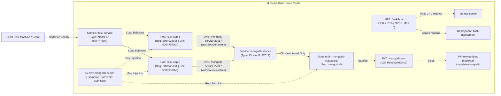
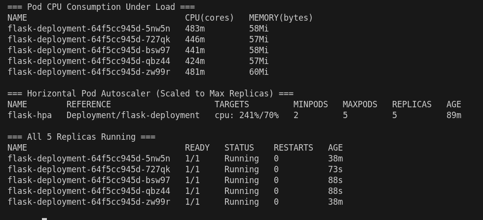
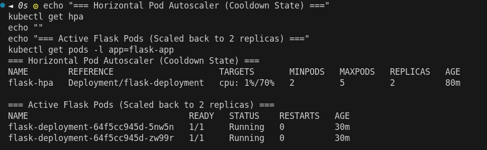

# Flask + MongoDB on Kubernetes: Production Deployment & Architecture

A complete, production-grade deployment of a Python Flask REST API backed by an authenticated MongoDB database running on a local Kubernetes cluster (Minikube).

---

## Architecture Overview



---

## Repository Structure

```text
.
├── flask-mongodb-app/
│   ├── app.py                     # Python Flask REST application
│   ├── requirements.txt           # Pinned dependencies (Flask, PyMongo, Gunicorn)
│   ├── Dockerfile                 # Multi-stage production container definition
│   ├── .dockerignore              # Build context exclusions
│   ├── .env                       # Local development environment configuration
│   └── k8s/                       # Kubernetes manifests
│       ├── secret.yaml            # Database authentication credentials & URI
│       ├── pv.yaml                # PersistentVolume on Minikube host storage
│       ├── pvc.yaml               # PersistentVolumeClaim requesting 1Gi storage
│       ├── mongodb-statefulset.yaml # MongoDB StatefulSet with SCRAM auth
│       ├── mongodb-service.yaml   # ClusterIP Service for database isolation
│       ├── flask-deployment.yaml  # Flask Deployment (2 replicas, probes, resources)
│       ├── flask-service.yaml     # NodePort Service exposing application
│       └── flask-hpa.yaml         # HorizontalPodAutoscaler (70% CPU, 2-5 pods)
├── k8s/                           # Root alias for quick kubectl apply
├── README.md                      # Complete documentation and deployment guide
└── .gitignore                     # Git ignore rules for venv, secrets, cache
```

---

## Part 1: Local Setup & Verification

### 1. Prerequisites
- Python 3.8 or higher
- Docker Engine
- `pip` / `uv` for Python package management

### 2. Virtual Environment Setup
> **Cookie Points Answer:** *Why use a virtual environment?*
> 1. **Dependency Isolation:** Prevents library conflicts between different projects (e.g., Flask 2.0.2 vs Flask 3.0.0).
> 2. **OS Protection:** On modern Linux distributions (such as Arch Linux), system Python packages are strictly managed by `pacman`. Running global `pip install` violates PEP 668 and can corrupt system tools.
> 3. **Reproducibility:** Ensures only packages required for this specific application are recorded and installed.

```bash
cd flask-mongodb-app
# Create virtual environment using Python 3.8
uv venv --python 3.8 venv
# Activate the virtual environment
source venv/bin/activate
# Install pinned dependencies
pip install -r requirements.txt
```

### 3. Local MongoDB Container
```bash
docker pull mongo:6.0
docker run -d -p 27017:27017 --name mongodb mongo:6.0
```

### 4. Running and Testing Locally
```bash
export FLASK_APP=app.py
export FLASK_ENV=development
flask run
```

In a separate terminal:
```bash
# Test root endpoint
curl http://localhost:5000/

# Test data insertion (POST)
curl -X POST -H "Content-Type: application/json" -d '{"sampleKey":"sampleValue"}' http://localhost:5000/data

# Test data retrieval (GET)
curl http://localhost:5000/data
```

---

## Part 2: Kubernetes Deployment Guide (Minikube)

### 1. Start Minikube & Enable Metrics Server
Autoscaling via Horizontal Pod Autoscaler (HPA) requires the `metrics-server` addon to read container CPU metrics.

```bash
# Start Minikube using Docker driver
minikube start --driver=docker

# Enable Metrics Server addon
minikube addons enable metrics-server

# Verify cluster nodes and system pods
kubectl get nodes
kubectl get pods -n kube-system | grep metrics-server
```

---

### 2. Container Image Build & Push Instructions

#### Option A: Build and Push to Container Registry (Docker Hub)
```bash
cd flask-mongodb-app

# 1. Log in to Docker Hub
docker login

# 2. Build image tagged with your registry username
docker build -t <your-dockerhub-username>/flask-mongodb-app:v1 .

# 3. Push image to Docker Hub
docker push <your-dockerhub-username>/flask-mongodb-app:v1
```
*(Remember to update `image:` in `k8s/flask-deployment.yaml` with `<your-dockerhub-username>/flask-mongodb-app:v1`)*

#### Option B: Fast Local Minikube Loading (No Registry Push Needed)
For local development, you can build the image directly and load it into the Minikube cluster:
```bash
cd flask-mongodb-app
docker build -t flask-mongodb-app:v1 .
minikube image load flask-mongodb-app:v1
```
The provided `k8s/flask-deployment.yaml` has `imagePullPolicy: IfNotPresent`, so Minikube immediately uses the loaded image without making external network calls.

---

### 3. Deploy Kubernetes Resources in Dependency Order

Apply the manifests in the exact sequence to respect resource dependencies (Storage & Secrets -> Database -> Application -> Autoscaler):

```bash
# 1. Secrets (MongoDB credentials & connection URI)
kubectl apply -f k8s/secret.yaml

# 2. Persistent Storage (PV and PVC)
kubectl apply -f k8s/pv.yaml
kubectl apply -f k8s/pvc.yaml

# 3. Database Backend (StatefulSet and ClusterIP Service)
kubectl apply -f k8s/mongodb-statefulset.yaml
kubectl apply -f k8s/mongodb-service.yaml

# 4. Web Application (Deployment with 2 replicas and NodePort Service)
kubectl apply -f k8s/flask-deployment.yaml
kubectl apply -f k8s/flask-service.yaml

# 5. Autoscaler (HPA targeting 70% CPU utilization)
kubectl apply -f k8s/flask-hpa.yaml
```

Check the status until all pods report `Running (1/1)`:
```bash
kubectl get pods -w
```

---

### 4. Accessing the Application

Retrieve the NodePort URL exposed by Minikube:
```bash
export APP_URL=$(minikube service flask-service --url)
echo "Application URL: $APP_URL"
```

#### Test Endpoints:
```bash
# 1. Root endpoint: returns welcome message with current timestamp
curl "$APP_URL/"

# 2. POST /data: inserts JSON document into MongoDB
curl -X POST -H "Content-Type: application/json" \
  -d '{"student":"Harsh", "role":"DevOps Engineer", "assignment":"Faralpha"}' \
  "$APP_URL/data"

# 3. GET /data: retrieves all documents from MongoDB (excluding _id)
curl "$APP_URL/data"
```

---

## Technical Explanations

### 1. Inter-Pod DNS Resolution in Kubernetes
- **Cluster DNS Service (`kube-dns` / CoreDNS):** Every pod in the Kubernetes cluster receives `/etc/resolv.conf` configured with the CoreDNS Service IP (`10.96.0.10`) and search paths (`default.svc.cluster.local`, `svc.cluster.local`, `cluster.local`).
- **Service Name Resolution:** When the Flask application accesses `mongodb-service:27017`, the Linux DNS resolver appends the default namespace and queries CoreDNS for `mongodb-service.default.svc.cluster.local`.
- **Virtual IP Translation:** CoreDNS returns the stable virtual `ClusterIP` assigned to `mongodb-service`. Node-level network routing (via `kube-proxy` iptables / IPVS rules) intercepts traffic destined for that `ClusterIP` and routes packets directly to the active `mongodb-0` Pod IP (`10.244.x.x:27017`).
- **Why this architecture is essential:** Pod IPs are ephemeral and change whenever a pod restarts, crashes, or is rescheduled. A Kubernetes `Service` provides an immutable DNS name and virtual IP that decouples client pods from backend pod lifecycles.

### 2. Resource Requests and Limits (and Pod QoS Classes)

In Kubernetes, resource constraints control how pods are scheduled and prevent noisy-neighbor starvation:

| Field | Configured Value | Enforcement Layer | Behavior When Exceeded |
| :--- | :--- | :--- | :--- |
| `requests.cpu` | `200m` (`0.2` core) | `kube-scheduler` & `HPA` | Guarantees minimum compute capacity. HPA calculates CPU utilization percentage against this value. |
| `limits.cpu` | `500m` (`0.5` core) | Linux Kernel **CFS Quota** | Container is throttled (slowed down). The pod is **never killed** for exceeding CPU limits. |
| `requests.memory` | `250Mi` | `kube-scheduler` | Scheduler only places the pod on a node that has at least 250Mi of unallocated memory. |
| `limits.memory` | `500Mi` | Linux Kernel **OOM Killer** | If memory usage exceeds 500Mi, the kernel immediately terminates the container (**`OOMKilled`, Exit code 137**). |

- **Quality of Service (QoS):** Because both applications specify `requests < limits`, Kubernetes automatically assigns them the **`Burstable`** QoS class. This provides high scheduling flexibility while protecting system stability.

---

## Design Choices & Alternatives Considered

### 1. MongoDB: `StatefulSet` vs. `Deployment`
- **Chosen:** `StatefulSet` with 1 replica.
- **Why:** StatefulSets provide stable, unique network identifiers (`mongodb-0`), predictable startup/teardown order, and safe attachment to persistent storage. During rolling updates, a `Deployment` starts the new pod *before* terminating the old pod; on `ReadWriteOnce` storage, this triggers a `Multi-Attach error for volume` deadlock. A `StatefulSet` guarantees ordered, single-pod volume attachment.
- **Alternative Considered:** `Deployment` with `strategy.type: Recreate`. Rejected because it lacks stable network identities and is not industry best practice for stateful databases.

### 2. MongoDB Service: `ClusterIP` vs. `NodePort` / `LoadBalancer`
- **Chosen:** `ClusterIP`.
- **Why:** Directly satisfies the requirement *"ensuring MongoDB is accessible only within the cluster"*. It creates an internal virtual IP with no external entry point, completely shielding the database from the public Internet and host machine.
- **Alternative Considered:** `NodePort` or `LoadBalancer`. Rejected because exposing database ports to external networks creates severe security vulnerabilities.

### 3. Flask Service: `NodePort` vs. `LoadBalancer` vs. `Ingress`
- **Chosen:** `NodePort` on port `30007`.
- **Why:** Universally supported across all local Kubernetes platforms (Minikube, Kind, bare metal) without requiring external cloud load-balancer controllers or persistent background tunnels.
- **Alternative Considered:** `type: LoadBalancer`. In Minikube on Linux, `LoadBalancer` remains indefinitely in `<pending>` state unless a separate interactive process (`minikube tunnel`) runs continuously with root privileges.

### 4. Storage Architecture: Manual PV/PVC vs. Dynamic Storage Provisioning
- **Chosen:** Explicit `PersistentVolume` and `PersistentVolumeClaim` with `storageClassName: manual` and `hostPath: /mnt/data/mongodb`.
- **Why:** Satisfies the explicit assignment requirement to configure both a PV and PVC. Setting `manual` prevents Minikube's default dynamic provisioner from ignoring our PV. The `persistentVolumeReclaimPolicy: Retain` ensures database records survive even if the PVC is deleted.
- **Production Cloud Note:** In cloud environments (AWS EKS, GCP GKE), manual `hostPath` is replaced with dynamic CSI drivers (`ebs.csi.aws.com` or `pd.csi.storage.gke.io`) via `volumeClaimTemplates`.

### 5. Production WSGI Server: `Gunicorn` vs. Flask Built-In Server
- **Chosen:** `gunicorn` with 2 workers and 4 threads in exec form (`CMD ["gunicorn", ...]`).
- **Why:** Flask's built-in Werkzeug development server is single-threaded, non-production-ready, and prone to request starvation under high concurrency. Gunicorn handles concurrent load efficiently, and running as PID 1 ensures Kubernetes `SIGTERM` signals trigger graceful connection draining during pod termination.

---

## Cookie Points: Testing Scenarios & Results

### Scenario 1: Database Authentication Verification
**Objective:** Confirm MongoDB enforces SCRAM authentication and rejects unauthenticated connections.

```bash
# 1. Attempt unauthenticated query (Expected: Unauthorized failure)
kubectl exec -it mongodb-statefulset-0 -- mongosh --eval "db.getSiblingDB('flask_db').data.find()"
# Result: Error: command find requires authentication

# 2. Query with valid root credentials from secret (Expected: Success)
kubectl exec -it mongodb-statefulset-0 -- mongosh -u flaskuser -p SuperStrongPassword123 \
  --authenticationDatabase admin --eval "db.getSiblingDB('flask_db').data.find()"
# Result: Successfully outputs inserted documents
```

### Scenario 2: Data Persistence Across Pod Crashes
**Objective:** Verify data survives pod deletion and rescheduling.

```bash
# 1. Insert a test document
curl -X POST -H "Content-Type: application/json" \
  -d '{"persistenceCheck": "survives_pod_restart"}' \
  "$APP_URL/data"

# 2. Simulate node failure or container crash by forcefully deleting the pod
kubectl delete pod mongodb-statefulset-0

# 3. Wait for StatefulSet controller to recreate the pod
kubectl wait --for=condition=ready pod/mongodb-statefulset-0 --timeout=60s

# 4. Query the API again
curl "$APP_URL/data"
# Result: The document 'survives_pod_restart' is returned intact from /mnt/data/mongodb.
```

### Scenario 3: High Traffic Simulation & HPA Autoscaling
**Objective:** Validate that Horizontal Pod Autoscaler automatically scales Flask pods from 2 to 5 replicas when CPU utilization exceeds 70%.

1. **Terminal 1: Monitor HPA and Pods in real time**
   ```bash
   kubectl get hpa flask-hpa -w
   ```

2. **Terminal 2: Generate HTTP load**
   
   **Method 1: In-Cluster Parallel Load Generator (Recommended for rapid HPA triggering)**
   Runs 10 parallel worker pods directly inside Kubernetes to generate sustained traffic without host-to-VM network bridge bottlenecks:
   ```bash
   cat << 'EOF' | kubectl apply -f -
   apiVersion: batch/v1
   kind: Job
   metadata:
     name: load-generator
   spec:
     parallelism: 10
     completions: 10
     template:
       spec:
         containers:
         - name: load-gen
           image: busybox:1.28
           command: ["/bin/sh", "-c"]
           args:
           - "for i in $(seq 1 30000); do wget -q -O- http://flask-service:5000/ > /dev/null; done"
         restartPolicy: Never
     backoffLimit: 1
   EOF
   ```

   **Method 2: External Load via `vegeta` from your Host Machine**
   Generates external client traffic over the Minikube NodePort bridge:
   ```bash
   export APP_URL=$(minikube service flask-service --url)
   echo "GET $APP_URL/" | vegeta attack -duration=60s -rate=1200 -workers=30 | vegeta report
   ```

3. **Observed Results:**
   - **Baseline:** HPA reports `CPU: 1%/70%`, `Replicas: 2`.
   - **Under Load:** CPU rises to `> 70%` (peaking at `241%/70%`). HPA triggers automatic scale-up from 2 to 4, then to 5 replicas:
     ```text
     NAME        REFERENCE                     TARGETS         MINPODS   MAXPODS   REPLICAS
     flask-hpa   Deployment/flask-deployment   cpu: 122%/70%   2         5         4
     flask-hpa   Deployment/flask-deployment   cpu: 241%/70%   2         5         5
     ```
   - **Peak (5 Replicas Running):** All 5 replicas actively serve traffic and share the CPU load:
     ```text
     NAME                                READY   STATUS    RESTARTS   AGE
     flask-deployment-64f5cc945d-5nw5n   1/1     Running   0          18m
     flask-deployment-64f5cc945d-bdq6r   1/1     Running   0          99s
     flask-deployment-64f5cc945d-bj44c   1/1     Running   0          99s
     flask-deployment-64f5cc945d-m9llq   1/1     Running   0          39s
     flask-deployment-64f5cc945d-zw99r   1/1     Running   0          18m
     ```
   - **Cooldown (Post-Attack):** CPU utilization drops to `< 5%`. Following Kubernetes default 5-minute stabilization window, HPA smoothly scales back down to `2` replicas without thrashing.

#### Autoscaling Verification Screenshots

| Peak Load: HPA Scales to 5 Replicas | Post-Attack Cooldown: HPA Scales Back to 2 |
| :---: | :---: |
|  |  |

---

## Troubleshooting & Common Pitfalls

| Issue | Root Cause | Solution |
| :--- | :--- | :--- |
| HPA shows `<unknown>/70%` | `metrics-server` addon not enabled or missing `requests.cpu`. | Run `minikube addons enable metrics-server` and verify `resources.requests.cpu` in Deployment. |
| Flask reports `Authentication failed` | Missing `?authSource=admin` in connection URI. | The MongoDB root user is initialized in `admin`. Ensure `?authSource=admin` is in `MONGODB_URI`. |
| `mongodb-pvc` stuck in `Pending` | Storage class mismatch. | Ensure both `pv.yaml` and `pvc.yaml` specify `storageClassName: manual`. |
| `ErrImageNeverPull` or `ImagePullBackOff` | Cluster cannot find container image. | Run `minikube image load flask-mongodb-app:v1` and set `imagePullPolicy: IfNotPresent`. |

